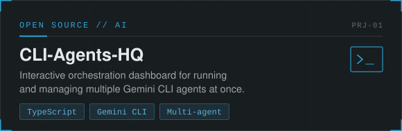
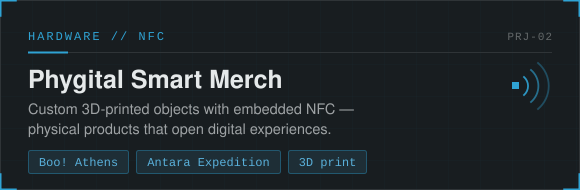
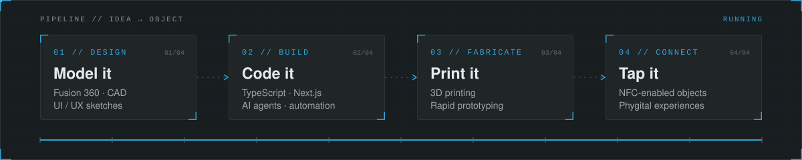
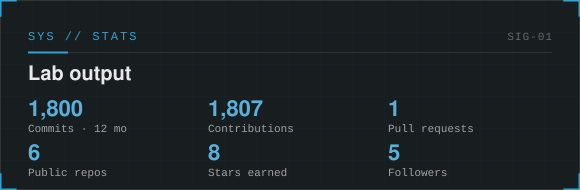
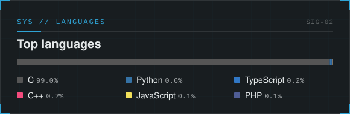

  

  <b>Websites, custom software and 3D-printed objects — designed, coded and fabricated in one lab.</b>

  
  
  
  

### `▸ 01 // ABOUT THE LAB`

- 🛠️ **What I build** — full-stack web apps and 3D-designed hardware, often in the same project.
- 🤖 **Exploring** — AI orchestration: running fleets of CLI agents to automate the complex so the creative part stays human.
- ⚡ **How I work** — rapid prototyping. Idea on Monday, printed and tappable by Friday.
- 💬 **Ask me about** — Next.js, Fusion 360, 3D printing, NFC merch, multi-agent workflows.
- 📍 Based in **Greece**.

### `▸ 02 // FEATURED WORK`

  
  

### `▸ 03 // FROM IDEA TO OBJECT`

  

### `▸ 04 // TOOLBOX`

**Code** 

**Make** 

**AI** 

### `▸ 05 // SIGNALS`

  
  

  

  <code>END OF TRANSMISSION</code> · Built in the lab · Attica, Greece 🇬🇷 · <a href="https://damianslab.gr">damianslab.gr</a>

